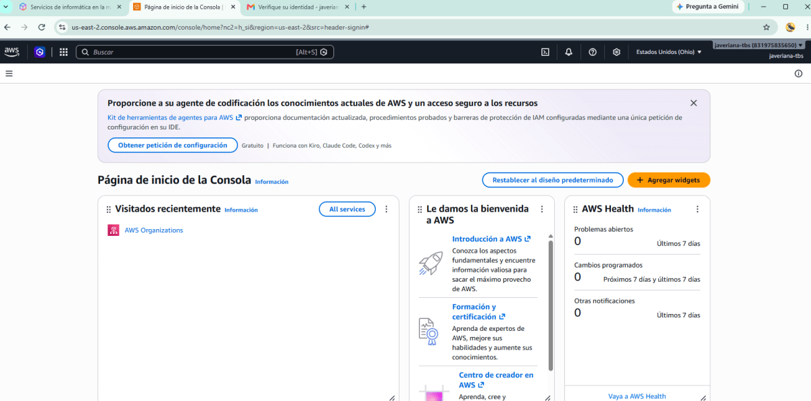
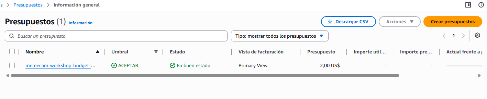
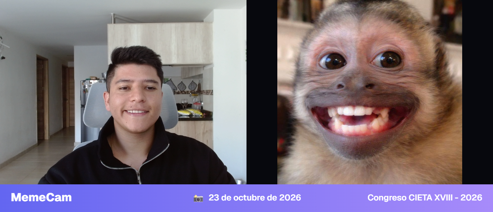

# MemeCam · Hands-on Serverless con AWS Lambda

App que reconoce gestos de la cara y las manos con MediaPipe (en el navegador)
y responde con un meme distinto por cada gesto. El backend es serverless en AWS:
API Gateway, cinco funciones Lambda, DynamoDB y S3, con el frontend publicado en Amplify Hosting.

El paso a paso completo está en el tutorial:
[Hands-on Serverless: tu primera app en la nube con AWS Lambda](https://www.ajteaches.dev/)

---

## Requisitos

- Programación básica en Python o JavaScript
- Python 3 instalado (solo para servir la app en local)
- Chrome o Edge con cámara
- Una cuenta de AWS (crearla es el Step 0 del tutorial)

## Probar MemeCam en local

```bash
cd frontend
python -m http.server 8000
```

Abrir http://localhost:8000 y hacer clic en **Activar cámara**. Con `API_URL` vacío en `frontend/config.js`, la app funciona en modo local con las imágenes de `frontend/memes/`.

## Qué hay en cada carpeta

| Carpeta        | Contenido                                                        |
|----------------|------------------------------------------------------------------|
| `frontend/`    | La app: interfaz, detección de gestos y conexión con la API      |
| `lambdas/`     | El código de las cinco funciones Lambda                          |
| `test-events/` | Eventos para probar cada Lambda desde la consola                 |
| `iam/`         | La política del rol de las Lambdas y la configuración CORS de S3 |
| `evidence/`    | Capturas del montaje completo en AWS                             |

## Arquitectura

| Ruta o evento                  | Lambda                  | Qué hace                                    |
|--------------------------------|-------------------------|---------------------------------------------|
| `GET /memes`                   | `memecam-list-memes`    | Devuelve los memes con URLs prefirmadas     |
| `POST /memes/upload-url`       | `memecam-upload-url`    | Da permiso temporal para subir un meme      |
| S3 `ObjectCreated` en `memes/` | `memecam-register-meme` | Registra en DynamoDB cada imagen subida     |
| `POST /events`                 | `memecam-track-event`   | Suma 1 al gesto detectado                   |
| `GET /stats`                   | `memecam-get-stats`     | Devuelve el ranking de gestos               |

---

## MemeCam funcionando

Así se ve el montaje completo en AWS, de la cuenta nueva hasta la app publicada. Si en algún paso del tutorial algo no se ve igual, estas capturas sirven de referencia.

### Step 0 - Cuenta de AWS con MFA


### Step 1 - Alerta de presupuesto


### Step 3 - MemeCam en local


### Step 7 - Memes registrados por el trigger de S3


### Step 8 - Rutas de la API


### Step 9 - Pruebas de la API


### Step 10 - MemeCam publicada en Amplify


### Step 11 - Ranking en vivo

